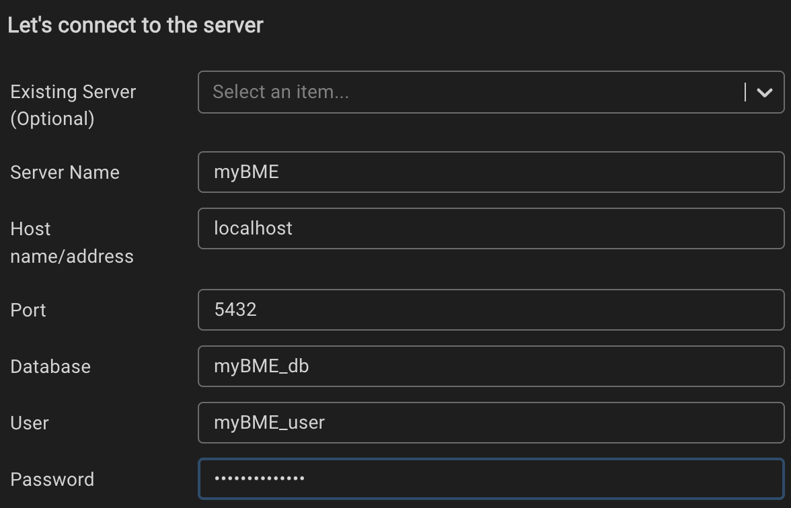

# myBME

A simple platform that ties together various services for BME students to access all from one point.

# How to set up

## Database
We use PostgreSQL. The configuration of the database can be found in the [root compose.yml](compose.yml) file. To run it, run `docker compose up -d` in your terminal from the root folder. (`-d` flag is for _detached_ (from terminal) mode)

After starting the database, you may want to look at it. For that, you may use pgAdmin. There, open the *Query Tool Workspace* or *PSQL Workspace* and fill all the details from the compose file. For my local setup it was the following:



- Server name: **myBME**
- Host name/address: **localhost**
- Port: **5432**
- Database: **myBME_db**
- User: **myBME_user**
- Password: _read in compose.yml or in your environment file_

## Migrations
To run database migrations:
1. launch databasee (`docker compose up -d`)
2. Go to the backend folder (`cd backend`)
3. Activate venv (`source .venv/bin/activate`)
4. Install dependencies (`pip install .`)
5. Run migrations (`alembic upgrade head`)

```
docker compose up -d
cd backend
source .venv/bin/activate
pip install .
alembic upgrade head
```

### Database setup verification:
1. Connect to the database in the pgAdmin
2. Query all tables: `select * from information_schema.tables`. At the end of the list you should see the created tables
